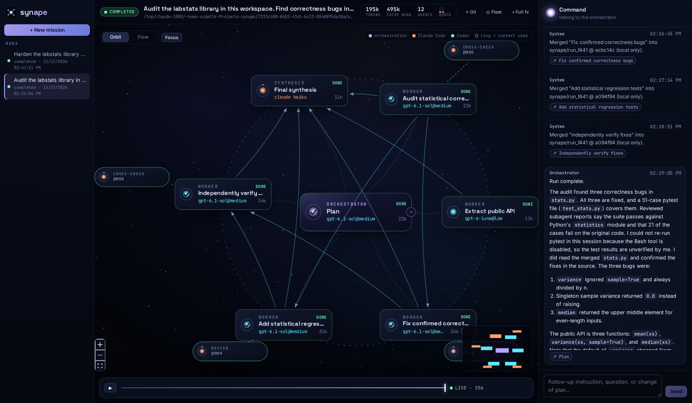

<p align="center"></p>

<h1 align="center">synape</h1>

<p align="center"><b>A visual, event-sourced orchestration engine for Claude Code and Codex agents.</b><br>
Describe an objective; watch a hierarchy of agents plan, delegate, execute, cross-check and synthesize it in a live graph.</p>



## What it does

- **Hierarchical orchestration.** An orchestrator decomposes your objective into a dependency graph. Workstreams can get their own **sub-orchestrators**, and workers can ask to be promoted when a task turns out to be too large. Everything is bounded by depth, concurrency, task, agent, retry, timeout and token limits.
- **Real cross-provider execution.** Workers are real `claude` (Claude Code) and `codex` CLI sessions running under *your existing logins*. One run freely mixes both.
- **Routing for cost per verified result.** Each task goes to the model with the lowest expected `execution + retry + verification + escalation` cost among models likely to pass. The estimate uses explicit priors plus a local performance history. Every decision is explained.
- **Independent verification.** Important results are reviewed or recomputed by a *different* model family. Rejected work is revised, escalating to a stronger tier on evidence. Unresolved disagreement is kept and labelled rather than smoothed over.
- **Event-sourced.** One append-only log drives the scheduler, the live graph, the resource dashboard, time-travel replay and crash recovery, all through the same reducer.
- **Honest accounting.** Exact tokens (including cache read and write) per agent, task and provider. Claude's subscription windows are shown as reported. Costs appear only where a provider reports them, labelled for what they are.
- **Safe by construction.** Permission ceilings with approvals, provider-enforced tool allowlists and sandboxes, git worktree isolation, a boundary audit of your checkout, and approval-gated merge, push and PR.

## Requirements

- Linux (macOS likely works; untested), **Node.js ≥ 23.6** (native TypeScript), pnpm.
- At least one provider, installed and logged in:
  - [Claude Code](https://docs.claude.com/en/docs/claude-code): `claude` on PATH, logged in.
  - [Codex CLI](https://github.com/openai/codex): `codex` on PATH, `codex login`.
- Optional: `git` (worktree isolation), `gh` (pull requests).

## Quick start

```bash
pnpm install
pnpm build            # builds the UI
pnpm start            # engine + UI on http://127.0.0.1:7420
```

Development, with hot reload for both sides:

```bash
pnpm dev              # engine on :7420, Vite UI on http://localhost:5173
```

Headless:

```bash
pnpm synape providers
pnpm synape run "Audit this repo for correctness bugs, fix them, add tests, verify independently" \
  --workspace ~/code/project --ceiling execute
pnpm synape ls
pnpm synape status <runId> [--at <seq>]       # state as of any event: time travel in the CLI
pnpm synape events <runId> --type task.routed,review.verdict
```

Data lives in `~/.local/share/synape` (override with `SYNAPE_HOME`): `synape.db` (events, snapshots, history), `artifacts/`, `worktrees/`.

## Using the interface

| Area | What it shows |
|---|---|
| **Graph** (centre) | Tasks as cells. The soma colour shows the model family (ember = Claude, ion = Codex, violet = orchestration) and the membrane ring shows context used. Arrows are data dependencies, faint arcs are delegation, dashed satellites are reviews. Edges animate only while work flows along them, and particles mark real hand-offs. Switch between *Orbit* and *Flow*, collapse clusters, or use *Focus* to isolate a neighbourhood. |
| **Inspector** | Objective, acceptance criteria, result, reviews, agent state, tokens, context, escalations, dependencies, the live terminal and tool calls, artifacts (reports, diffs, plans, verdicts), and the routing explanation with the full candidate table. Expand it into a wide workspace. |
| **Command** (right) | Talk to the orchestrator: follow-up instructions re-plan the live graph. Select an agent and tick *Ask … directly* to question it in its own resumed session (read-only). Approvals appear here. Task chips focus the graph. |
| **HUD** (top) | Tokens, cache reads, agents and subscription windows. Click it for the full resource breakdown. Pause, resume and cancel live there too, along with *Git* (approval-gated publication) and *Fleet* (providers, catalog, learned performance). |
| **Timeline** (bottom) | Scrub or replay the whole run from the persisted event log. |

## Configuration

Each run is configured in the *New mission* dialog or through the API:

| Setting | Default | Meaning |
|---|---|---|
| `permissionCeiling` | `read` | Highest permission without approval: `read`, `write`, `execute` or `network` |
| `extraDirs` | `[]` | Extra readable directories (e.g. a shared tool installation or dataset) |
| `providers` | all available | Restrict to a subset |
| `qualityBias` | `0.5` | 0 = economy, 1 = reliability (raises the success bar) |
| `limits.maxDepth` | 2 | Delegation depth (root = 0) |
| `limits.maxConcurrentAgents` | 6 | Per run |
| `limits.providerConcurrency` | claude 4, codex 3 | Global per provider |
| `limits.maxAgentsPerTask` / `maxTotalAgents` / `maxTasks` | 5 / 40 / 40 | Spawn control |
| `limits.maxRetries` / `taskTimeoutMs` | 2 / 30 min | |
| `budgets.maxTokens` / `maxTaskTokens` / `maxApiUsd` | 3M / – / – | The run pauses and asks for approval when exceeded |

Environment: `SYNAPE_HOME`, `SYNAPE_PORT`, `SYNAPE_CLAUDE_BIN`, `SYNAPE_CODEX_BIN`.

The model catalog with its skill priors and resource weights is in `packages/core/src/models.ts`. Its values are documented assumptions and are refined automatically by observed outcomes.

## Example: a real run

The screenshot above is a real run on a small Python library. Codex `gpt-6.1-sol` planned it. A light `gpt-6-luna` extracted the API, Codex wrote the fixes and tests in isolated worktrees, every critical task was cross-checked by Claude Sonnet (which re-ran pytest itself: 51 passed), and Claude Haiku wrote the final synthesis. That came to 12 agents and 195k tokens (+495k cache reads), with 20% of tokens spent on verification and 12% on retries. Verified work was merged into the local branch `synape/<run>`, and nothing touched the user's branch.

See [docs/WORKFLOWS.md](docs/WORKFLOWS.md) for more workflows, including a research literature-review scenario.

## Documentation

- [Architecture and decisions](docs/ARCHITECTURE.md)
- [Security model](docs/SECURITY.md)
- [Workflows](docs/WORKFLOWS.md)
- [Limitations](docs/LIMITATIONS.md)

## Development

```bash
pnpm test        # vitest: router, reducer, scheduler, recovery, review loop…
pnpm typecheck
```

Engine tests use a scripted, test-only provider (`packages/engine/test/fakes.ts`) to pin down scheduling semantics deterministically. That provider is never registered by the application, and everything the UI shows comes from real executions.

## License

TBD (see LICENSE).
