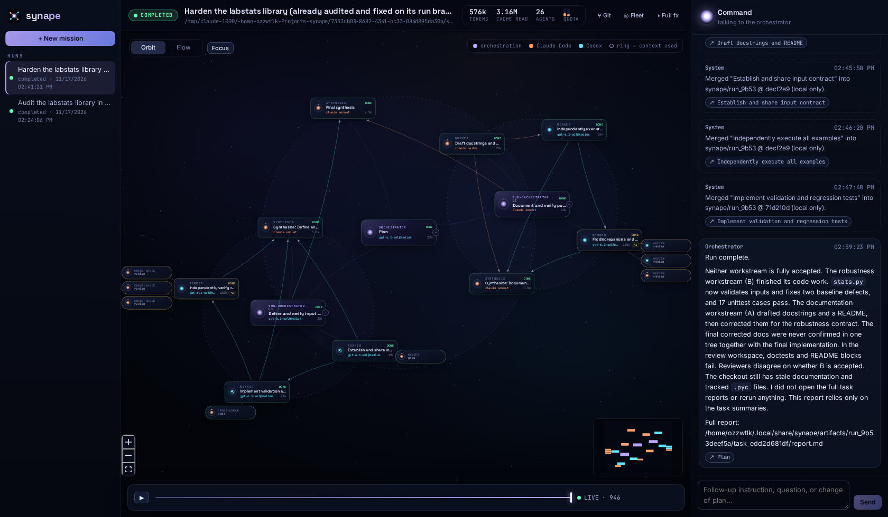
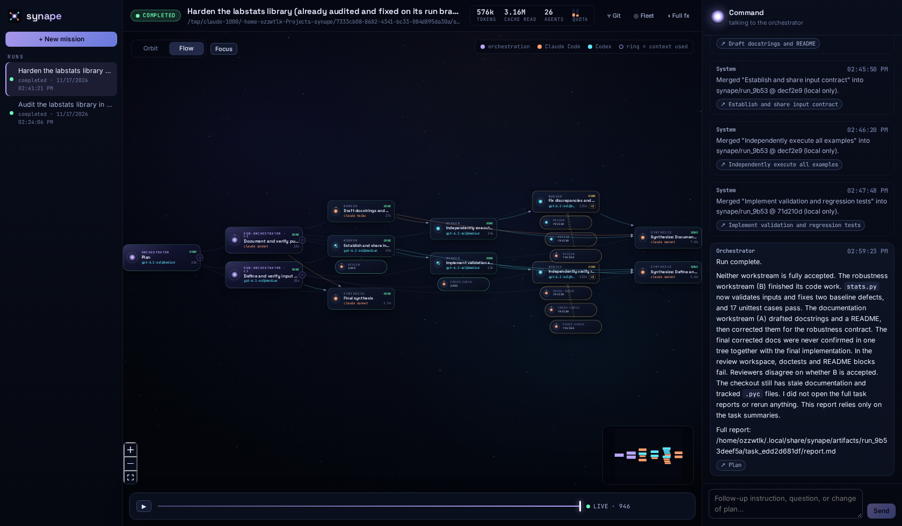
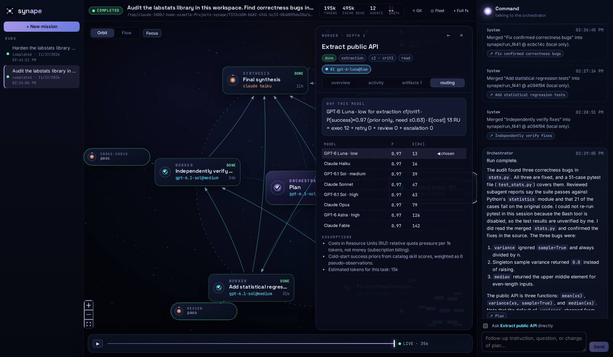
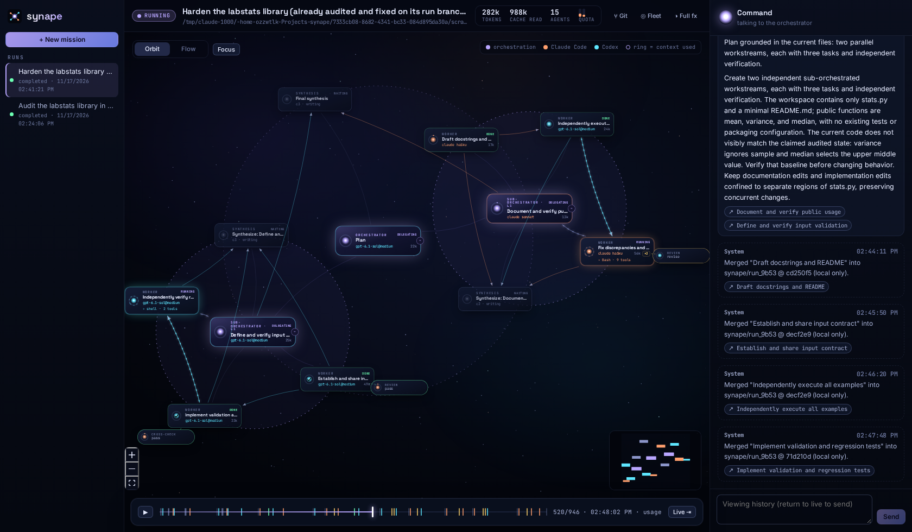
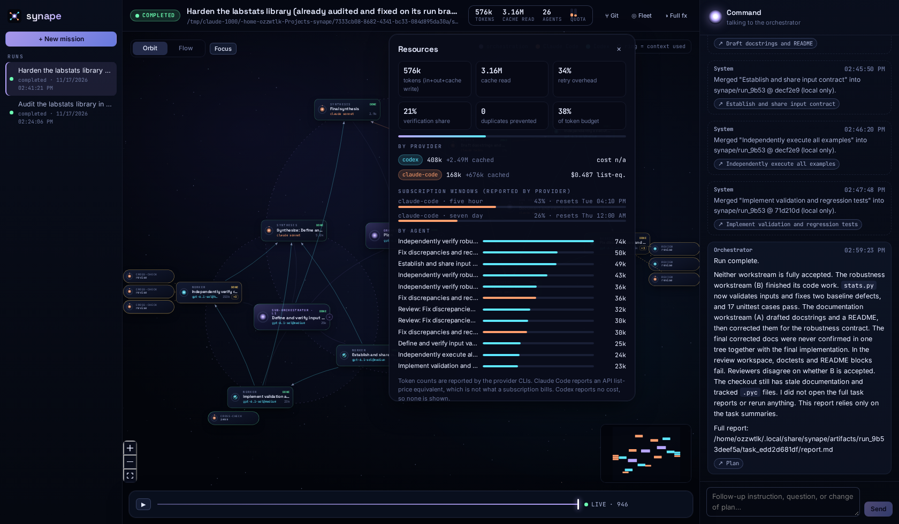

<p align="center"></p>

<h1 align="center">synape</h1>

<p align="center"><b>A research orchestrator for Claude Code and Codex agents.</b><br>
State a scientific objective. A hierarchy of agents plans it, runs the derivations, literature checks and computations, has every key result independently re-derived by a different model family, and traces each figure in your manuscript back to the agent that produced it.</p>



## For research

Synape was built for scientific work, where a result is only worth something once it has been checked, and you need to know where every number and plot came from.

- **Cross-checked results.** Derivations and numerical results are recomputed by a different model family (Claude ↔ Codex) by an independent route. Disagreements are reported rather than averaged away, and every node shows whether its result is *verified*, *unverified* or *disputed*.
- **Computations you can see.** Running Python, Wolfram/Mathematica, MadGraph, micrOMEGAs, Julia, ROOT, Pythia, Delphes, LaTeX, compilers or your own `./binary` shows up live as small satellites on the node that ran it. Each program has a stable colour derived from its name, and hovering shows the last command.
- **Paper & figures.** A built-in PDF viewer for the manuscript, plus a provenance panel. It shows every figure the agents produced, grouped by the node that produced it (with model and verification status), and which figures `main.tex` actually `\includegraphics`, following `\input`/`\include`. Figures are snapshotted when an agent finishes, so later edits can't rewrite provenance.
- **Outputs per node.** Each node's *Outputs* tab lists exactly the files it wrote. In git workspaces this is checked against git, so a fresh worktree checkout isn't mistaken for work.
- **A short answer at the end.** The final synthesis leads with a TL;DR (the result with its uncertainty, what is verified, the biggest open issue). The *Summary* panel opens when a run finishes, with verification counts, failures, deliverables and per-workstream one-liners.
- **A local model for the bulky work.** Reading and digesting PDFs, extraction and summaries can run on your own GPU through llama.cpp (default: Qwen3.6-35B-A3B, 160k context), costing no subscription quota. Its results are still reviewed by a cloud model of another family.
- **Runs that survive usage limits.** When a subscription window is exhausted, the run pauses and resumes automatically at the reset time, without spending retries. Models your plan doesn't include can be switched off, and any node can be pinned to a specific model.

## What it does

- **Hierarchical orchestration.** An orchestrator decomposes your objective into a dependency graph. Workstreams can get their own **sub-orchestrators**, and workers can ask to be promoted when a task turns out to be too large. Everything is bounded by depth, concurrency, task, agent, retry, timeout and token limits.
- **Real cross-provider execution.** Workers are real `claude` (Claude Code) and `codex` CLI sessions running under *your existing logins*. One run freely mixes both.
- **Routing for cost per verified result.** Each task goes to the model with the lowest expected `execution + retry + verification + escalation` cost among models likely to pass. The estimate uses explicit priors plus a local performance history. Every decision is explained. Codex is weighted ×3 for quota pressure (adjustable per provider in Fleet), so it gets only the work that really needs it.
- **Missions without context bloat.** When a mission finishes, its done nodes are archived into a short orchestrator memory (TL;DR, report paths, one line per result). Follow-ups plan from that digest instead of the whole old graph; *History* brings the old nodes back. Ask for a model in chat ("use Qwen for the PDF reading") and the orchestrator pins it.
- **Independent verification.** Important results are reviewed or recomputed by a *different* model family. Rejected work is revised, escalating to a stronger tier on evidence. Unresolved disagreement is kept and labelled rather than smoothed over.
- **Event-sourced.** One append-only log drives the scheduler, the live graph, the resource dashboard, time-travel replay and crash recovery, all through the same reducer.
- **Honest accounting.** Exact tokens (including cache read and write) per agent, task and provider. Claude's subscription windows are shown as reported. Costs appear only where a provider reports them, labelled for what they are.
- **Safe by construction.** Permission ceilings with approvals, provider-enforced tool allowlists and sandboxes, git worktree isolation, a boundary audit of your checkout, and approval-gated merge, push and PR.

## Screenshots

All screenshots come from real runs; nothing is mocked.

| | |
|---|---|
|  **Flow**: the same run, layered by dependency |  **Routing**: why a light model got the extraction task |
|  **Time travel**: the run at event 520 of 946 |  **Resources**: tokens, cache, subscription windows |

## Requirements

- Linux (macOS likely works; untested), **Node.js ≥ 23.6** (native TypeScript), pnpm.
- At least one provider, installed and logged in:
  - [Claude Code](https://docs.claude.com/en/docs/claude-code): `claude` on PATH, logged in.
  - [Codex CLI](https://github.com/openai/codex): `codex` on PATH, `codex login`.
  - Optional, a [local model](#local-models) through llama.cpp.
- Optional: `git` (worktree isolation), `gh` (pull requests), poppler (`pdftotext`, `pdftoppm`) for PDFs.

## Quick start

```bash
pnpm install
pnpm build            # builds the UI
pnpm start            # engine + UI on port 7420: this machine, your LAN and Tailscale
```

`pnpm start` prints an access link for each network it is reachable on (Tailscale MagicDNS name and IP, LAN IP). Open one once on each phone or laptop. The link's token is swapped for a cookie, so after that the plain address works. `pnpm synape url` prints the links again, and `--rotate` revokes every device. To stay on this machine only, use `pnpm start --host 127.0.0.1`.

Development, with hot reload for both sides:

```bash
pnpm dev              # engine on :7420, Vite UI on http://localhost:5173
```

Headless:

```bash
pnpm synape providers
pnpm synape run "Audit this repo for correctness bugs, fix them, add tests, verify independently" \
  --workspace ~/code/project --ceiling execute
pnpm synape ls
pnpm synape status <runId> [--at <seq>]       # state as of any event: time travel in the CLI
pnpm synape events <runId> --type task.routed,review.verdict
```

Data lives in `~/.local/share/synape` (override with `SYNAPE_HOME`): `synape.db` (events, snapshots, history), `artifacts/`, `worktrees/`.

## Using the interface

| Area | What it shows |
|---|---|
| **Graph** (centre) | Every node is drawn like a particle-detector event display, and every mark encodes real data. **Orchestrators** are progress dials: one outer segment per subtask, coloured by its state and flowing while it runs, with decay tracks to each child and energy deposits scaled by tokens. **Workers** show their tool activity over time as calorimeter towers (angle = time, height = activity, tint = program run), recent tool calls as tracks, an inner context-usage gauge, and a radar sweep while live. **Reviews** are reticles carrying the verdict. **Computations** are hexagonal crystals coloured by program. Colours: ember = Claude, ion = Codex, leaf = local model, violet = orchestration, green ring = verified. Switch between *Orbit* and *Flow*, collapse clusters, or use *Focus*. |
| **Summary / Paper** (top) | *★ Summary*: the TL;DR and verification status. *◫ Paper*: the manuscript PDF beside every produced figure and its provenance. |
| **Inspector** | Objective, acceptance criteria, result, reviews, agent state, tokens, context, escalations, dependencies, a model picker (pin this node to a model), the live terminal and tool calls, **outputs** (figures and files the node wrote, with previews), artifacts (reports, diffs, plans, verdicts), and the routing explanation with the full candidate table. Expand it into a wide workspace. |
| **Command** (right) | Talk to the orchestrator: follow-up instructions re-plan the live graph (after a finished mission, from its memory digest). Select an agent and tick *Ask … directly* to question it in its own resumed session (read-only). Approvals appear here. Task chips focus the graph. |
| **HUD** (top) | Tokens, cache reads, agents and subscription windows. Click it for the full resource breakdown. Pause, resume and cancel live there too, along with *Git* (approval-gated publication) and *Fleet* (providers, catalog, learned performance). |
| **Timeline** (bottom) | Scrub or replay the whole run from the persisted event log. |

## Remote access (LAN and Tailscale)

The server listens on all interfaces, but answers only loopback, private LAN (10/8, 172.16/12, 192.168/16, link-local) and Tailscale (100.64/10, `fd7a:115c:a1e0::/48`) addresses. Any other address gets 403. Requests from another device also need the access token, stored in `~/.local/share/synape/access-token` (mode 0600). Send it once with `?token=…`, which sets an HttpOnly cookie, or as `Authorization: Bearer …`. Requests from this machine don't need a token, but they must use a localhost, IP or `*.ts.net` host name, which blocks DNS rebinding. Mutations also need the per-process CSRF token, as before. The traffic itself is plain HTTP: over Tailscale it is encrypted by WireGuard, but on a shared LAN you should treat it as visible to others on the network.

## Local models

Synape can run agents on a local model served by [llama.cpp](https://github.com/ggml-org/llama.cpp). It starts `llama-server` the first time a task is routed to it, and stops it after 20 idle minutes to free the VRAM. It takes the bulky, low-difficulty work (PDF digests, extraction, summaries and simple edits), the same tier the router would give Haiku. Its tokens don't count against run budgets, and its results are still reviewed by a cloud model of another family.

**Default model.** [Qwen3.6-35B-A3B](https://huggingface.co/Qwen/Qwen3.6-35B-A3B) is an Apache-2.0 hybrid-attention MoE (35B total, 3B active, 262,144-token context). Qwen reports 73.4 on SWE-bench Verified for it, against about 73 for Claude Haiku 4.5. That makes it Haiku-class for agentic work, though weaker on hard reasoning. The default build is Unsloth's `UD-Q4_K_XL` with the multi-token-prediction head (22.9 GB).

**Tuned for one 16 GB GPU and 32 GB of RAM.** The adapter launches llama-server with:
- `--fit on`: attention, shared experts and the KV cache stay in VRAM, and the remaining routed experts are served from RAM.
- `-c 163840 -np 1`: a 160k-token context in one slot. See *Measured* below for why it isn't the native 262k.
- Flash attention and a q8 KV cache. Only 10 of the model's 40 layers keep a KV cache, so 160k costs about 1.7 GB.
- `-b 2048 -ub 2048` prompt batches: about 1.5× faster on long PDFs than 1024. Larger batches crash, see below.
- MTP speculative decoding (`--spec-type draft-mtp`). If that fails, it retries without it.
- Text only (no vision projector), and bound to `127.0.0.1`.
- Qwen's recommended sampling.

`pnpm synape local args` prints the exact command.

**Measured on an RX 6800 XT (Vulkan) with 32 GB of RAM:**
- The model loads in about 22 s.
- Generation runs at about 50 tokens/s, with 79% of MTP drafts accepted. At 109k tokens of context it is still 39 tokens/s.
- Prompt processing runs at 550 tokens/s at 33k tokens and averages about 350 tokens/s over 109k tokens. A 30-page paper (about 25k tokens) is read in under a minute.
- A planted fact was found correctly at 33k and at 109k tokens.

**Why 160k and not 262k.** Past about 200k tokens, single GPU jobs outlast the amdgpu driver's default compute timeout. The kernel resets the compute ring, and llama.cpp aborts with `vk DeviceLost`. This happened at 199k and 207k tokens, and at batch 8192 even below 109k. The reset is recoverable: the display keeps running. To try the full window, raise the timeout with the kernel parameter `amdgpu.lockup_timeout=10000,60000` (graphics, compute in ms), reboot, and set `ctx` to 262144. That configuration is untested here.

**Tools and skills.** The local agent has its own tool loop, gated by the same permission levels as the CLI agents:
- `list_dir`, `read_file`, `grep` and `pdf_text` (paged, via poppler) when reading;
- `write_file` and `edit_file` with write permission;
- `bash` with execute permission.

Paths are confined to the workspace and its extra directories, and the check follows symlinks. A built-in skills preamble tells the model how to work. For example, it digests a PDF in 12-page chunks and cites pages, and extracts values with units and sources or says "not found". The local slot runs one task at a time. Once two tasks are queued for it, further easy tasks go to the cloud instead.

```bash
# 1. llama.cpp: unpack a release (Vulkan build for AMD/Intel; CUDA/ROCm builds also work)
mkdir -p ~/.local/opt && cd ~/.local/opt
curl -LO https://github.com/ggml-org/llama.cpp/releases/download/<tag>/llama-<tag>-bin-ubuntu-vulkan-x64.tar.gz
tar xzf llama-*-vulkan-x64.tar.gz && ln -sfn "$PWD/llama-<tag>" ~/.local/opt/llama.cpp
# 2. the model (resumable, sha256-verified)
scripts/get-local-model.sh
# 3. check
pnpm synape local status
```

| Setting (`settings.json` → `local`, or env) | Default | |
|---|---|---|
| `url` / `SYNAPE_LOCAL_URL` | `http://127.0.0.1:8091` | Use an already running server instead |
| `bin` / `SYNAPE_LLAMA_SERVER` | newest `~/.local/opt/llama.cpp*/llama-server`, else PATH | |
| `model` / `SYNAPE_LOCAL_MODEL` | best `.gguf` in `~/.local/share/llm/models` | |
| `ctx` / `SYNAPE_LOCAL_CTX` | 163840 | |
| `idleMinutes` / `SYNAPE_LOCAL_IDLE_MIN` | 20 | 0 keeps it loaded |
| `autostart` / `SYNAPE_LOCAL_AUTOSTART` | true | |
| `vramMarginMiB`, `extraArgs` | 768, `[]` | VRAM left for the desktop; extra llama-server flags |

The server log is at `~/.local/share/synape/local-llm.log`. You can switch the model off in *Fleet*, or pin any node to it from the Inspector.

## Configuration

Each run is configured in the *New mission* dialog or through the API:

| Setting | Default | Meaning |
|---|---|---|
| `permissionCeiling` | `read` | Highest permission without approval: `read`, `write`, `execute` or `network` |
| `extraDirs` | `[]` | Extra readable directories (e.g. a shared tool installation or dataset) |
| `providers` | all available | Restrict to a subset |
| `qualityBias` | `0.5` | 0 = economy, 1 = reliability (raises the success bar) |
| `limits.maxDepth` | 2 | Delegation depth (root = 0) |
| `limits.maxConcurrentAgents` | 6 | Per run |
| `limits.providerConcurrency` | claude 4, codex 3, local 1 | Global per provider |
| `limits.maxAgentsPerTask` / `maxTotalAgents` / `maxTasks` | 5 / 40 / 40 | Spawn control |
| `limits.maxRetries` / `taskTimeoutMs` | 2 / 30 min | |
| `budgets.maxTokens` / `maxTaskTokens` / `maxApiUsd` | 3M / – / – | The run pauses and asks for approval when exceeded |

Environment: `SYNAPE_HOME`, `SYNAPE_PORT`, `SYNAPE_HOST` (default `0.0.0.0`), `SYNAPE_ALLOWED_HOSTS` (extra local host names), `SYNAPE_CLAUDE_BIN`, `SYNAPE_CODEX_BIN`, and the `SYNAPE_LOCAL_*` variables above.

The model catalog with its skill priors and resource weights is in `packages/core/src/models.ts`. Its values are documented assumptions and are refined automatically by observed outcomes.

## Example: a real run

The screenshot above is a real run on a small Python library. Codex `gpt-6.1-sol` planned it. A light `gpt-6-luna` extracted the API, Codex wrote the fixes and tests in isolated worktrees, every critical task was cross-checked by Claude Sonnet (which re-ran pytest itself: 51 passed), and Claude Haiku wrote the final synthesis. That came to 12 agents and 195k tokens (+495k cache reads), with 20% of tokens spent on verification and 12% on retries. Verified work was merged into the local branch `synape/<run>`, and nothing touched the user's branch.

A second real run used two **sub-orchestrators** (documentation and robustness), 26 agents and 946 events. The server was **hard-killed (SIGKILL) mid-run** and restarted: recovery killed the orphaned agent process, marked the agents interrupted, and resumed both provider sessions with a 152-character continuation prompt. `synape verify` confirms that replaying the log reproduces the persisted state exactly. Its reviewers also found a real engine bug: execute-level reviewers were placed in a fresh worktree and could not see the author's changes. They refused to pass the work, the final report stated that neither workstream was fully accepted, and the bug is now fixed with a regression test.

See [docs/WORKFLOWS.md](docs/WORKFLOWS.md) for more workflows, including a research literature-review scenario.

## Documentation

- [Architecture and decisions](docs/ARCHITECTURE.md)
- [Security model](docs/SECURITY.md)
- [Workflows](docs/WORKFLOWS.md)
- [Limitations](docs/LIMITATIONS.md)

## Development

```bash
pnpm test        # vitest: router, reducer, scheduler, recovery, review loop…
pnpm typecheck
```

Engine tests use a scripted, test-only provider (`packages/engine/test/fakes.ts`) to pin down scheduling semantics deterministically. That provider is never registered by the application, and everything the UI shows comes from real executions.

## License

[MIT](LICENSE). Third-party dependencies (React, React Flow, marked, DOMPurify, Fontsource fonts, Vite, Vitest, Playwright) are under MIT, Apache-2.0, MPL-2.0/Apache-2.0 (DOMPurify) or OFL-1.1 (fonts) licenses.
